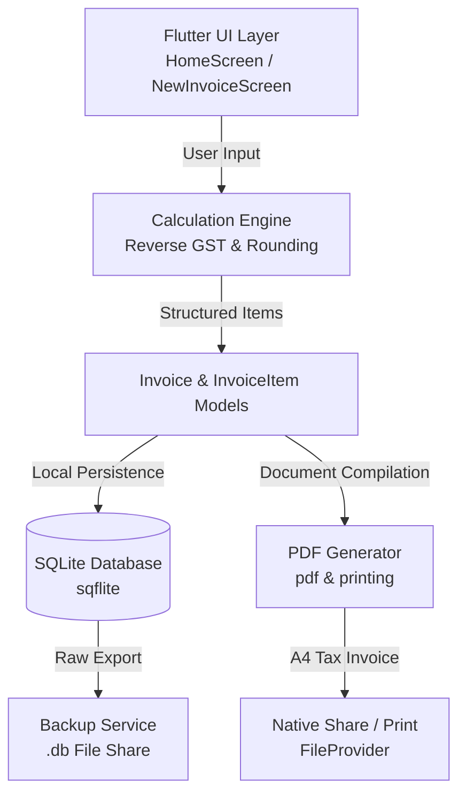

# A1 Battery Billing Pro – Offline GST Billing & Invoicing Flutter App

[](https://github.com/krishnakumar-2001/a1-battery-billing-app/actions)
[](LICENSE)
[](https://flutter.dev)
[](https://dart.dev)

A modern, offline-first mobile and desktop point-of-sale (POS) billing and invoice generation application built with Flutter and SQLite. Designed for automobile and inverter battery dealerships to automate GST calculations, manage serial numbers, generate standard A4 tax invoice PDFs, and maintain business records with zero cloud dependency.

---

## Table of Contents

- [Overview](#overview)
- [Problem Statement & Objectives](#problem-statement--objectives)
- [Key Features](#key-features)
- [GST Calculation Engine](#gst-calculation-engine)
- [Architecture & Data Flow](#architecture--data-flow)
- [Technology Stack](#technology-stack)
- [Repository Structure](#repository-structure)
- [Prerequisites & System Requirements](#prerequisites--system-requirements)
- [Installation & Developer Setup](#installation--developer-setup)
- [Configuration & Customization](#configuration--customization)
- [Running the Application](#running-the-application)
- [Testing & Quality Assurance](#testing--quality-assurance)
- [Troubleshooting](#troubleshooting)
- [Known Limitations & Roadmap](#known-limitations--roadmap)
- [Contributing](#contributing)
- [License](#license)
- [Author](#author)

---

## Overview

Retail battery dealers in India face unique billing challenges: prices quoted to end customers are typically **tax-inclusive** (18% GST), yet commercial tax compliance mandates standard tax invoices displaying backward-calculated taxable value, CGST (9%), SGST (9%), HSN/SAC codes, warranty serial numbers per battery unit, and total amounts rendered in Indian words (Lakhs and Crores).

**A1 Battery Billing Pro** solves this with an intuitive, offline POS mobile workflow that calculates precise tax splits with zero rounding errors, generates publication-ready A4 PDF invoices, and allows instant sharing or printing.

---

## Problem Statement & Objectives

* **Manual Math & Floating Point Drift:** Retailers manually computing 18% GST from inclusive amounts frequently experience 1-rupee rounding mismatches between line items and grand totals.
* **Warranty Tracking:** Batteries require individual serial numbers on the tax invoice for manufacturer warranty claims.
* **Network Reliability:** Small shops and industrial zones often lack stable internet connections; billing software must run 100% offline.
* **Data Ownership:** Shop owners need simple, zero-friction local backups without recurring subscription databases.

---

## Key Features

* 🧮 **Precision GST Back-Calculation:** Automatically calculates taxable value, 9% CGST, and 9% SGST from retail tax-inclusive rates with zero floating-point drift.
* 🔢 **Auto-Incrementing Invoices:** Sequential, persistent numbering generated from SQLite (`MAX(invoice_no) + 1`).
* 🏷️ **Line-Item Serial Number Tracking:** Enter multi-line serial numbers per battery, formatted inline in the final invoice.
* 📄 **Professional A4 PDF Generation:** Comprehensive tax invoice layout adhering to Indian GST guidelines including HSN codes, company details, declaration, and authorized signatory.
* 🖨️ **Native Print & Share:** Integrated with the Android share sheet and system print services via `printing` and `share_plus`.
* 💾 **Database Backup & Migration:** 1-click export of SQLite `.db` database via share sheet, and instant file restoration via file picker.
* 🗣️ **Indian Number System Converter:** Converts totals to words adhering to Indian currency conventions (e.g., *₹1,25,000 -> One Lakh Twenty Five Thousand Rupees Only*).
* ⚡ **Search & History Management:** Search previous records by customer name or invoice number with swipe-to-delete support.

---

## GST Calculation Engine

In the retail battery trade, items are sold at a single sticker price inclusive of 18% GST. The application's `CalculationEngine` executes reverse tax calculation:

$$\text{Taxable Per Unit} = \frac{\text{Rate}_{\text{incl}}}{1.18}$$

$$\text{Subtotal} = \text{Taxable Per Unit} \times \text{Quantity}$$

$$\text{Taxable Value} = \text{round}_2\left(\text{Subtotal} - \text{Discount Amount}\right)$$

$$\text{CGST (9\%)} = \text{round}_2(\text{Taxable Value} \times 0.09)$$

$$\text{SGST (9\%)} = \text{round}_2(\text{Taxable Value} \times 0.09)$$

$$\text{Line Total} = \text{round}_2(\text{Taxable Value} + \text{CGST} + \text{SGST})$$

$$\text{Grand Total} = \text{round}\left(\sum \text{Line Total}\right)$$

*Note:* All cents/paise values are computed using `(val * 100).round() / 100.0` to eliminate standard IEEE-754 binary floating-point rounding errors.

---

## Architecture & Data Flow



---

## Technology Stack

| Layer | Technology | Purpose |
|---|---|---|
| **Language** | Dart 3.x | Core application programming language |
| **Framework** | Flutter 3.x | Cross-platform UI toolkit (Material 3) |
| **Local Database** | `sqflite` ^2.3.3 | SQLite engine for invoices and product catalogues |
| **PDF Generation** | `pdf` ^3.10.8 | Vector A4 document rendering |
| **Printing & Sharing**| `printing`, `share_plus` | Android native print spooler & intent sharing |
| **File Management** | `path_provider`, `file_picker` | File system access for backup/restore |
| **Typography & UI** | `google_fonts` (Inter), `intl` | Clean UI styling and currency formatting |

---

## Repository Structure

```
.
├── .github/
│   └── workflows/
│       └── flutter_ci.yml          # Automated CI: analyze & test
├── android/                        # Android native wrapper & manifests
│   └── app/src/main/
│       ├── AndroidManifest.xml     # FileProvider and storage permissions
│       └── res/xml/file_paths.xml  # Secure file sharing paths
├── assets/
│   └── image.png                   # Launcher icon & branding
├── lib/
│   ├── database/
│   │   └── database_helper.dart    # SQLite schema, migrations, CRUD
│   ├── models/
│   │   ├── invoice_item_model.dart # Line item data model & JSON mapping
│   │   └── invoice_model.dart      # Complete invoice domain model
│   ├── screens/
│   │   ├── home_screen.dart        # Metrics overview and quick actions
│   │   ├── new_invoice_screen.dart # Multi-item billing form
│   │   ├── invoice_detail_screen.dart # PDF preview, print, and export
│   │   ├── invoice_history_screen.dart# Filterable invoice ledger
│   │   └── settings_screen.dart    # Product catalog & backup management
│   ├── services/
│   │   ├── backup_service.dart     # SQLite import/export operations
│   │   ├── calculation_engine.dart # Exact GST tax logic
│   │   └── pdf_generator.dart      # A4 tax invoice layout engine
│   ├── utils/
│   │   ├── constants.dart          # Configuration, shop details, GST rates
│   │   ├── helpers.dart            # Currency & date formatters
│   │   └── number_to_words.dart    # Indian numbering words engine
│   └── widgets/
│       └── product_item_widget.dart# Dynamic invoice row controller & UI
├── test/
│   ├── calculation_engine_test.dart# Precision tax unit tests
│   ├── invoice_model_test.dart     # Serialization tests
│   ├── number_to_words_test.dart   # Currency converter tests
│   └── product_item_widget_test.dart # Widget smoke tests
├── pubspec.yaml                    # Flutter dependencies
├── CHANGELOG.md                    # Release history
├── CONTRIBUTING.md                 # Contribution guidelines
├── LICENSE                         # MIT License
└── README.md                       # Project documentation
```

---

## Prerequisites & System Requirements

- **Operating System:** Windows 10/11, macOS, or Linux
- **Flutter SDK:** `>= 3.2.0 < 4.0.0`
- **Dart SDK:** `>= 3.0.0 < 4.0.0`
- **Android Studio / VS Code** with Flutter & Dart extensions
- **Target OS Support:** Android 5.0+ (API Level 21+) or Windows Desktop

---

## Installation & Developer Setup

1. **Clone the Repository:**
   ```bash
   git clone https://github.com/krishnakumar-2001/a1-battery-billing-app.git
   cd a1-battery-billing-app
   ```

2. **Install Flutter Dependencies:**
   ```bash
   flutter pub get
   ```

3. **Verify Environment Health:**
   ```bash
   flutter doctor
   ```

---

## Configuration & Customization

Shop profile information and default tax rates are managed centrally in `lib/utils/constants.dart`:

```dart
// lib/utils/constants.dart
class AppConstants {
  static const String shopName       = 'YOUR SHOP NAME';
  static const String shopAddress    = 'Your Shop Address, City, State - PIN';
  static const String gstin          = '33XXXXXXXXXX1ZX';
  static const String phone          = '+91 XXXXX XXXXX';

  // Bank Details for Invoices
  static const String bankName       = 'Your Bank Name';
  static const String bankAccount    = '000000000000';
  static const String bankIfsc       = 'IFSC0000000';

  // Default Tax Settings
  static const double gstRatePercent = 18.0; // 9% CGST + 9% SGST
}
```

*Note:* Inventory items can be added, modified, or removed dynamically at runtime from the in-app **Settings Screen** without code changes.

---

## Running the Application

### Connect a physical Android device or launch an emulator, then:

```bash
# Run in debug mode
flutter run

# Build a release APK
flutter build apk --release
```

The compiled release APK will be generated at:  
`build/app/outputs/flutter-apk/app-release.apk`

---

## Testing & Quality Assurance

The codebase includes automated unit tests covering financial calculation accuracy, data model serialization, and UI rendering.

```bash
# Run static analysis
flutter analyze

# Run all automated tests
flutter test
```

### Test Suite Coverage:
- `test/calculation_engine_test.dart`: Verifies 18% reverse calculation, discount reductions, and whole-rupee rounding.
- `test/number_to_words_test.dart`: Validates Indian numbering system output (Lakhs, Crores, Paise).
- `test/invoice_model_test.dart`: Validates JSON and SQLite serialization.
- `test/product_item_widget_test.dart`: Tests line-item widget rendering and inputs.

---

## Troubleshooting

| Problem | Cause | Solution |
|---|---|---|
| **PDF share fails on Android** | Missing FileProvider configuration | Ensure `android/app/src/main/res/xml/file_paths.xml` is present and referenced in `AndroidManifest.xml`. |
| **Database file not found during restore** | Permission denied on external storage | Verify storage permissions in Android Settings for the application. |
| **Gradle build error on modern Java** | Incompatible Gradle JVM arguments | Check `android/gradle.properties` memory allocations and use JDK 17. |

---

## Known Limitations & Roadmap

- [x] Full offline billing and SQLite storage
- [x] A4 PDF generation with GST compliance
- [x] Database export and import
- [ ] Thermal POS printer (Bluetooth 58mm/80mm ESC/POS) support
- [ ] Barcode / QR scanner integration for rapid serial number input
- [ ] Multi-rate GST support (e.g. 12% and 28% mixed categories)

---

## Contributing

Contributions are welcome! Please read [CONTRIBUTING.md](CONTRIBUTING.md) for details on code style, branch naming conventions, and the pull request process.

---

## License

This project is licensed under the MIT License - see the [LICENSE](LICENSE) file for details.

---

## Author

**Krishna Kumar**  
GitHub: [@krishnakumar-2001](https://github.com/krishnakumar-2001)  
LinkedIn: [Connect with me](https://www.linkedin.com)
